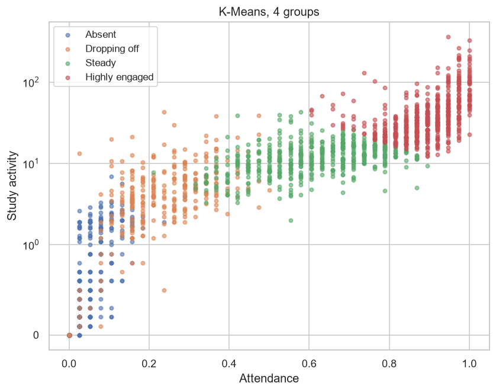

# Student clusters

Grouping students by learning pattern (attendance, study activity and assignment completion) with hierarchical clustering and K-Means, on 1,655 real students of an Open University course. Both methods find the same four groups, and the groups predict final results that neither method saw. An interactive demo re-runs both methods live.



## Results

| Group (K-Means) | Students | Attendance | Clicks per week | Assignments handed in | Passed | Failed | Withdrew |
| --- | --- | --- | --- | --- | --- | --- | --- |
| Highly engaged | 564 (34%) | 89% | 45 | 99% | 89% | 9% | 2% |
| Steady | 506 (31%) | 61% | 12 | 93% | 56% | 31% | 13% |
| Dropping off | 301 (18%) | 24% | 6 | 46% | 2% | 34% | 63% |
| Absent | 284 (17%) | 5% | 1 | 4% | 0% | 19% | 81% |

- **k = 4** is the most stable choice: K-Means runs from 10 random starts agree at 0.99 (adjusted Rand index), against 0.97 for k = 3 and 0.91 for k = 5.
- **Hierarchical (Ward) finds the same four groups.** Every student it calls absent or highly engaged, K-Means does too; the two differ at the borders (agreement 0.59), mostly 192 students between steady and highly engaged.
- **Linkage matters.** At k = 4, Ward's silhouette is 0.41 with groups of 645, 396, 372 and 242. Single linkage chains 1,651 students into one group (silhouette 0.08).
- **Handing work in isn't enough.** Steady students submit 93% of assignments, yet 31% fail; they click a quarter as much as the engaged group.

Full tables and figures: [docs/results.md](docs/results.md). How it was done: [docs/methodology.md](docs/methodology.md).

## Run it

Needs Python 3.14+ and [uv](https://docs.astral.sh/uv/).

```bash
uv sync
uv run python main.py
uv run streamlit run app.py
```

`main.py` reads `prepared/students.csv` and writes figures and tables to `outputs/`, the K-Means pipeline to `models/` and `docs/results.md`. To rebuild the student table from the raw dataset (a 47 MB download): `uv run python scripts/build_students.py`.

## The demo

- **Overview**: the methods and what was found.
- **Explore**: hierarchical clustering with any linkage, or K-Means, for any k, with the merge tree and each group's final results.
- **Place a student**: enter attendance, study activity and completion; see the group and the advice for it.
- **Results**: the saved tables and figures.

## Layout

```
student_clusters/   data.py (inputs), groups.py (names and advice), report.py
pxlab/              shared engine (vendored): clustering, plots, app helpers
prepared/           students.csv, one row per student
scripts/            build_students.py, rebuilds students.csv from OULAD
main.py             the full study
app.py              the Streamlit demo
docs/               methodology, results, deploy
```

## Data

Kuzilek, J., Hlosta, M. and Zdrahal, Z. (2017). Open University Learning Analytics dataset. *Scientific Data* 4, 170171. Downloaded from the [UCI Machine Learning Repository](https://archive.ics.uci.edu/dataset/349/open+university+learning+analytics+dataset) under [CC BY 4.0](https://creativecommons.org/licenses/by/4.0/). `prepared/students.csv` is derived from it (one course presentation, aggregated per student, no student IDs) and is under the same license.

## License

Code: MIT. `prepared/students.csv`: CC BY 4.0.
