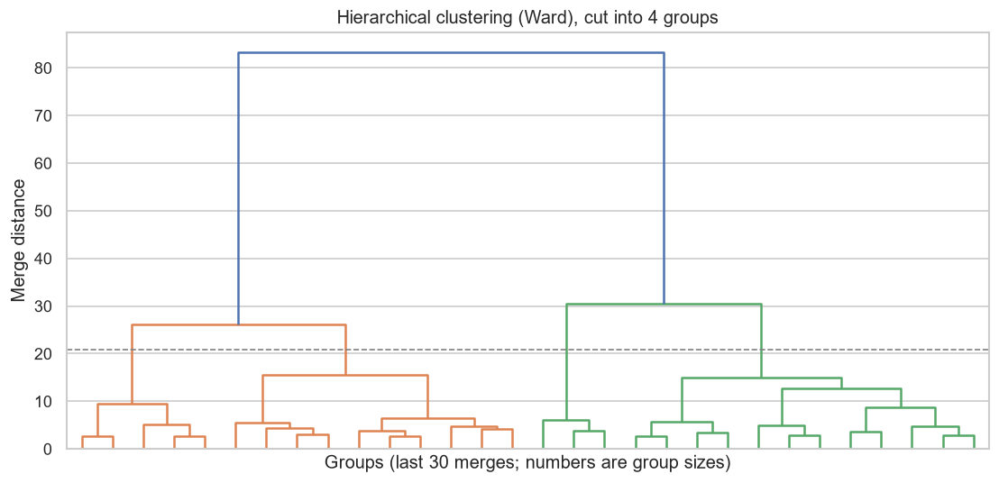
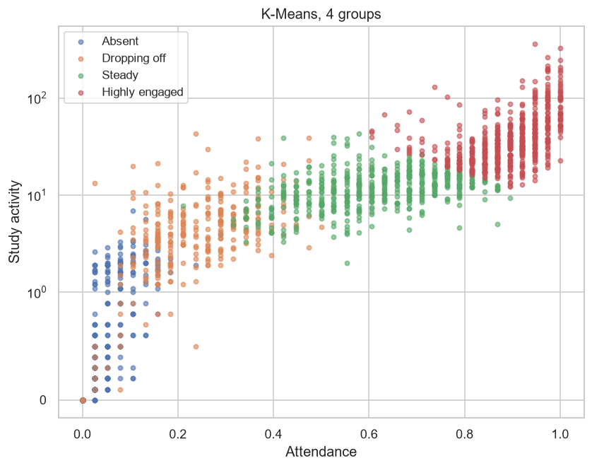
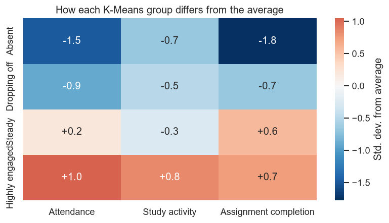
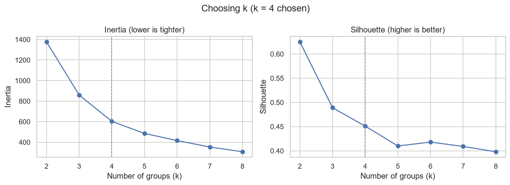

# Results

Produced by `python main.py` on 1,655 students. K-Means with 20 random starts, seed 42. Agreement between the Ward and K-Means groupings (adjusted Rand index): 0.59.

## Hierarchical

### Hierarchical (Ward) groups

| Group | Students | Share | Attendance | Study activity | Assignment completion | Distinction | Pass | Fail | Withdrawn | Advice |
| --- | --- | --- | --- | --- | --- | --- | --- | --- | --- | --- |
| Absent | 242 | 0.15 | 0.04 | 0.62 | 0.01 | 0.0 | 0.0 | 0.17 | 0.83 | Contact in the first weeks: they barely log in and hand in almost nothing, and most withdraw. |
| Dropping off | 396 | 0.24 | 0.26 | 6.6 | 0.46 | 0.0 | 0.04 | 0.32 | 0.64 | Follow up after the first missed assignment: they start, then stop about halfway. |
| Steady | 645 | 0.39 | 0.69 | 15.55 | 0.96 | 0.08 | 0.59 | 0.27 | 0.06 | Study skills support: they hand in nearly everything, yet about three in ten fail. |
| Highly engaged | 372 | 0.22 | 0.92 | 56.71 | 1.0 | 0.17 | 0.77 | 0.06 | 0.01 | Stretch material: they log in almost every week and most pass, many with distinction. |

### Linkage methods compared

| Linkage | Silhouette | Group sizes |
| --- | --- | --- |
| ward | 0.406 | 645, 396, 372, 242 |
| average | 0.385 | 1001, 303, 286, 65 |
| complete | 0.311 | 675, 518, 361, 101 |
| single | 0.079 | 1651, 2, 1, 1 |

## K-Means

### K-Means groups

| Group | Students | Share | Attendance | Study activity | Assignment completion | Distinction | Pass | Fail | Withdrawn | Advice |
| --- | --- | --- | --- | --- | --- | --- | --- | --- | --- | --- |
| Absent | 284 | 0.17 | 0.05 | 0.83 | 0.04 | 0.0 | 0.0 | 0.19 | 0.81 | Contact in the first weeks: they barely log in and hand in almost nothing, and most withdraw. |
| Dropping off | 301 | 0.18 | 0.24 | 5.85 | 0.46 | 0.0 | 0.02 | 0.34 | 0.63 | Follow up after the first missed assignment: they start, then stop about halfway. |
| Steady | 506 | 0.31 | 0.61 | 12.41 | 0.93 | 0.05 | 0.51 | 0.31 | 0.13 | Study skills support: they hand in nearly everything, yet about three in ten fail. |
| Highly engaged | 564 | 0.34 | 0.89 | 45.41 | 0.99 | 0.15 | 0.74 | 0.09 | 0.02 | Stretch material: they log in almost every week and most pass, many with distinction. |

## Choosing k

### Scores for each k

| k | Inertia | K-Means silhouette | Ward silhouette | Stability (mean) | Stability (lowest) |
| --- | --- | --- | --- | --- | --- |
| 2 | 1376.847 | 0.625 | 0.596 | nan | nan |
| 3 | 859.252 | 0.489 | 0.521 | 0.967 | 0.948 |
| 4 | 602.975 | 0.451 | 0.406 | 0.992 | 0.97 |
| 5 | 485.478 | 0.41 | 0.365 | 0.909 | 0.801 |
| 6 | 415.758 | 0.418 | 0.364 | 0.718 | 0.511 |
| 7 | 353.198 | 0.409 | 0.384 | nan | nan |
| 8 | 306.901 | 0.398 | 0.379 | nan | nan |

## Comparison

### Students by Ward group (rows) and K-Means group (columns)

| Ward | Absent | Dropping off | Steady | Highly engaged |
| --- | --- | --- | --- | --- |
| Absent | 242 | 0 | 0 | 0 |
| Dropping off | 42 | 301 | 53 | 0 |
| Steady | 0 | 0 | 453 | 192 |
| Highly engaged | 0 | 0 | 0 | 372 |
